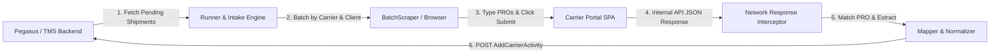

# WebScrapping Master Architecture & Rapid Triage Playbook

Welcome to the **WebScrapping** codebase guide. This playbook gives you an end-to-end mental model of the system, an exact map of every file and directory, and a **Rapid Incident Triage Matrix** so that whenever an issue arises, you can instantly locate the code and fix it.

---

## 1. The 30-Second Mental Model

### What Problem Does This System Solve?
In Less-Than-Truckload (LTL) motor freight logistics, carriers (e.g. Saia, Estes, Forward Air) do not provide open, free REST APIs for tracking. Instead, their public web portals use modern SPAs (Single Page Applications) that communicate with internal backend JSON endpoints.

Rather than brittle DOM scraping (parsing fragile HTML tags), **WebScrapping** drives real browser sessions (using stealth Chromium forks like **Patchright**), simulates human typing and form submission, and **intercepts the clean HTTP/JSON responses straight out of the browser's network layer**. It then normalizes these payloads into canonical tracking results and posts tracking updates to the Pegasus TMS/Backend.



---

## 2. System Anatomy & Directory Map

Here is the exact responsibility of every file in the project. If something breaks, find the relevant layer below:

```
WebScrapping/
├── main.py                             # Root stub entry point
├── config/
│   └── app.yaml                        # Global settings (backend URLs, jitter schedule, alerts, debug dirs)
├── app/
│   ├── main.py                         # CLI Composition root (run-once, daemon, assist commands)
│   ├── settings.py                     # Strict Pydantic models for config (Limits, BrowserConfig, SiteConfig)
│   ├── models.py                       # Core data domain models (CarrierAccount, TrackingJob, TrackingResult)
│   ├── logging_setup.py                # Contextual logging (injects client, carrier, run_id into logs; masks passwords)
│   │
│   ├── backend/                        # Backend TMS Integration
│   │   ├── client.py                   # HttpBackend & FileBackend (fetches configs/shipments, posts tracking)
│   │   ├── credentials.py              # Identity & credential resolvers (SecretStr decoders)
│   │   └── pegasus.py                  # Pegasus TMS API client client adapter
│   │
│   ├── browser/                        # Browser Automation Providers
│   │   ├── base.py                     # Abstract BrowserProvider & BrowserSession interfaces
│   │   ├── factory.py                  # Provider factory (instantiates Patchright or Playwright Stealth)
│   │   ├── playwright_provider.py      # Playwright + Patchright engine (stealth context, session reuse)
│   │   └── crawl4ai_provider.py        # Stub for crawl4ai provider
│   │
│   ├── core/                           # The Automation & Orchestration Engine
│   │   ├── runner.py                   # Top-level orchestrator: locks, concurrency, intake dispatching
│   │   ├── intake.py                   # Groups backend shipments by (billTo, carrierCode) into jobs
│   │   ├── scraper.py                  # BatchScraper: network interception, form typing, response picker
│   │   ├── adapter.py                  # GenericAdapter base class (subclasses implement custom carrier actions)
│   │   ├── mapper.py                   # Pure function JSON mapper: extracts fields & normalizes statuses
│   │   ├── carrier_activity.py         # Formats & submits Pegasus AddCarrierActivity payloads
│   │   ├── login.py                    # Automated credential entry & session authentication
│   │   ├── intervention.py             # Human CAPTCHA intervention queue (records blocked jobs in SQLite)
│   │   ├── resilience.py               # CircuitBreaker, Pacer (rate limiter), retry decorators
│   │   ├── scheduler.py                # JitterSchedule: calculates next randomized run times
│   │   ├── state.py                    # StateStore: SQLite key-value store for session timestamps & queues
│   │   ├── metrics.py                  # RunMetrics: tracks counts (ok, not_found, blocked, crashed)
│   │   └── registry.py                 # Dynamic adapter auto-discovery scanner
│   │
│   └── clients/                        # Multi-Tenant Client & Carrier Declarations
│       └── calix/                      # Client folder (Calix billTo: "CALIX", "134034")
│           ├── client.yaml             # Client-wide defaults (pending endpoint, status maps)
│           └── carriers/               # Carrier implementations for Calix
│               ├── estes/              # Estes Express
│               │   ├── mapping.yaml    # Site selectors, response regex, field paths
│               │   └── hooks.py        # Optional payload tweak hooks
│               ├── saia/               # Saia LTL Freight
│               │   ├── mapping.yaml    # Site selectors & configuration
│               │   └── adapter.py      # Custom adapter (Cloudflare Turnstile bypass & encrypted search handling)
│               └── forwardair/         # Forward Air
│                   └── mapping.yaml    # Site selectors, regex patterns, field normalization
└── scripts/
    ├── new_client.py                   # Scaffolds a new client folder
    ├── new_carrier.py                  # Scaffolds a new carrier folder
    └── probe.py                        # Standalone diagnostic tool to test carrier selectors
```

---

## 3. End-to-End Data & Execution Flow

### Step 1: Initialization & CLI (`app/main.py`)
- User or daemon runs `python -m app.main run-once` or `python -m app.main daemon`.
- `build()` loads `config/app.yaml` via `app/settings.py` (`load_settings()`), sets up structured logging, initializes SQLite `StateStore(state/tracker.db)`, and initializes `SpecResolver` which auto-discovers all client folders.
- The `Runner` instance is created with all dependency-injected services.

### Step 2: Intake (`app/core/intake.py` & `app/backend/client.py`)
- In Phase 2 (`_run_batch_once` in `app/core/runner.py`):
- `build_jobs(backend)` calls:
  1. `backend.get_carrier_configs()` -> downloads list of active carrier accounts for all billing codes.
  2. `backend.get_shipments(bill_to, carrier_code)` -> fetches pending housebills / PROs for each carrier.
- Organizes shipments into groups keyed by `(bill_to, carrier_code)`.

### Step 3: Batch Scraping (`app/core/scraper.py`)
- For each carrier group, `BatchScraper.run_batch(jobs, spec)` is executed:
  1. **Session Setup:** Obtains a browser session from `BrowserProvider` (reusing stored cookies from `state/browser/` to bypass re-logins).
  2. **Page Navigation:** Visits `spec.site.tracking_url`. Dismisses cookie consent banners automatically.
  3. **Batch Splitting:** Splits pending PRO numbers into batches according to `spec.site.batch_size` (e.g., 10 PROs at once if the carrier UI supports multiline input).
  4. **Typing & Submission:** Types PROs into `input_selector` with realistic human delays (`typing_delay_ms`), clicks `submit_selector`.
  5. **Network Sniffing:** Listens to all network responses matching `spec.site.response_url_pattern` or containing the PRO number in the JSON body.
  6. **Response Extraction:** Picks the captured JSON, matches it back to each PRO using `spec.site.response_pro_path`.
  7. **Single Retry:** Any PRO missing from the batch response is retried individually once.

### Step 4: Normalization & Backend Posting (`app/core/carrier_activity.py` & `app/core/mapper.py`)
- `enqueue_tracking_updates()` receives the raw scrape outcome.
- For each PRO:
  - If found: calls `normalize(raw, spec)` to extract standard fields (status, pickup date, delivery date, ETA, history events).
  - Determines Pegasus status ID via `pegasus_ml_status()` (e.g., 2 for ok, 4 for not_found, 3 for error).
  - Formats payload via `build_carrier_activity_payload()`.
  - Sends HTTP POST request to Pegasus endpoint `backend.carrier_activity_path` (or saves to `out/AddCarrierActivity/` in dry-run/file mode).

---

## 4. Rapid Incident Triage Matrix

When an error or alert happens, use this table to jump straight to the source file and line!

| What Went Wrong? | Error Message / Symptom | Where to Look First | Root Cause & Immediate Fix |
| :--- | :--- | :--- | :--- |
| **Site Selector Changed** | `TimeoutError: Waiting for selector ... failed` or `input_selector not found` | `app/clients/<client>/carriers/<carrier>/mapping.yaml` | The carrier redesigned their tracking form. Inspect the page, find the new CSS selector for the input or submit button, and update `site.input_selector` / `site.submit_selector`. |
| **Response Sniffer Missed** | `missing: [...]` or PROs marked as missing in batch scrape | `app/clients/<client>/carriers/<carrier>/mapping.yaml` (`site.response_url_pattern`, `site.response_pro_path`) | The carrier changed their internal REST API endpoint or payload structure. Open Chrome DevTools Network tab on the carrier site, search a PRO, find the XHR/Fetch request, and update `response_url_pattern` and `response_pro_path`. |
| **Bot Detection / Cloudflare / Turnstile** | `ChallengeError` or `BlockedError` (Cloudflare / reCAPTCHA challenge detected) | 1. `app/clients/.../mapping.yaml` (`browser.browser_mode: patchright`)<br>2. Run CLI Assist: `python -m app.main assist <carrier> --client <client>` | 1. Ensure `browser_mode` is set to `patchright` with `channel: chrome`.<br>2. If an interactive challenge appears, run the CLI `assist` command. A visible browser will open. Solve the challenge once; cookies will be saved in `state/browser/` and reused automatically! |
| **Backend / TMS Auth Failed** | `BackendAuthError: 401 Unauthorized` | `.env` (`TRACKER_API_TOKEN`), `config/app.yaml` (`auth_header`, `auth_scheme`) | The Pegasus API token is expired or missing. Check `.env` and verify credentials against the backend API docs. |
| **Data Mapping / Normalization Bug** | Status is `unknown`, ETA is null, or events missing in TMS | `app/core/mapper.py` & `app/clients/<client>/carriers/<carrier>/mapping.yaml` (`fields`, `status_map`) | The raw JSON structure changed. Check `fields` in `mapping.yaml`. Ensure `dotted.path` matches the new JSON structure. Add missing carrier status strings to `status_map`. |
| **Rate Limit / Circuit Breaker Tripped** | `Circuit breaker open for <carrier>` | `app/clients/<client>/carriers/<carrier>/mapping.yaml` (`limits: breaker_threshold, breaker_cooldown_s`) | The carrier is blocking requests due to rapid scraping. Adjust `limits.min_delay_s`, `limits.max_delay_s`, or reduce `batch_size`. Reset breaker in `state/tracker.db` if needed. |
| **Pegasus AddCarrierActivity 400 Bad Request** | `400 Client Error: ML status id is not valid` | `app/core/carrier_activity.py` & `app/clients/<client>/client.yaml` (`defaults.activity.ml_status_by_outcome`) | Pegasus requires specific numeric `mlStatus` values (e.g. 2=OK, 3=Error, 4=Not Found). Do not send 0 or 1. Update `client.yaml` under `activity`. |
| **Missing Carrier Configuration** | Log: `carrier not configured for this client` | `app/clients/<client>/carriers/` | The backend returned a carrier code that doesn't have a folder under `app/clients/<client>/carriers/`. Run `python scripts/new_carrier.py <client> <carrier_code> "<Name>"` to generate it. |

---

## 5. Carrier Architecture Deep-Dive

### How Generic vs. Custom Carriers Work

- **90% of Carriers (e.g. Estes, Forward Air):**
  - **Zero Python Code Required!**
  - All behavior is dictated by `mapping.yaml`.
  - The `GenericAdapter` in `app/core/adapter.py` and `BatchScraper` in `app/core/scraper.py` read:
    - `site.tracking_url`
    - `site.input_selector`
    - `site.submit_selector`
    - `site.response_url_pattern`
    - `site.response_pro_path`
    - `fields` and `status_map`

- **Complex Carriers (e.g. Saia):**
  - Requires custom `adapter.py` because Saia encrypts PRO numbers in the browser before sending the query and enforces Cloudflare Turnstile verification.
  - Saia inherits from `GenericAdapter` and overrides only lifecycle hooks:
    - `_on_landing(session)`: Waits for Cloudflare Turnstile token completion.
    - `_before_submit(session, pro)`: Handles Saia's encrypted parameter generation.

---

## 6. Essential Terminal Commands Cheat Sheet

Keep these commands handy for local development and rapid debugging:

```bash
# 1. Run a single test run with full debug output and dry-run (no live backend posts)
python -m app.main run-once --client calix --carrier estes --force --dry-run

# 2. Run for Saia (forces a fresh scrape, bypassing schedule check)
python -m app.main run-once --client calix --carrier saia --force

# 3. Solve a CAPTCHA / Bot challenge manually in a real browser (saves cookie session)
python -m app.main assist saia --client calix

# 4. Run the automated scheduler in background / server daemon mode
python -m app.main daemon

# 5. On a headless Linux server with Xvfb:
xvfb-run -a python -m app.main daemon

# 6. Create a brand new carrier under an existing client
python scripts/new_carrier.py calix rland "R+L Carriers"

# 7. Run unit tests
pytest -v
```

---

## 7. Key Data Schema Reference

### `TrackingResult` (Normalized Internal Format)
Defined in [app/models.py](file:///c:/Users/UshaKiranAlluri/Documents/plg-git-order/WebScrapping/app/models.py):
- `reference`: PRO / Housebill string
- `status`: Canonical status (`DELIVERED`, `IN_TRANSIT`, `OUT_FOR_DELIVERY`, `PICKED_UP`, `EXCEPTION`, `UNKNOWN`)
- `pickup_date`, `delivery_date`, `eta`: ISO timestamp strings
- `origin`, `destination`: Terminal/City strings
- `pieces`, `weight`: Normalized numbers
- `events`: Array of `TrackingEvent(timestamp, description, location, status)`

### Pegasus `AddCarrierActivity` Payload
Defined in [app/core/carrier_activity.py](file:///c:/Users/UshaKiranAlluri/Documents/plg-git-order/WebScrapping/app/core/carrier_activity.py):
- `housebill`: Client's internal housebill identifier
- `carrierCode`: Code assigned to carrier (e.g., `EXLA`, `SAIA`)
- `billTo`: Client billing account number (e.g., `134034`)
- `mlStatus`: Numeric ML status identifier (2 = success, 4 = not found, 3 = error)
- `activityDate`: UTC timestamp `yyyy-mm-ddTHH:MM:SSZ`
- `comments`: Scrape summary / status description
- `createdBy`: System actor ID (defaults to 1)
